# sudograph

Infrastructure for business people and LLMs to build, check, and improve a shared
understanding of a business. The long-term goal is that an LLM can understand the
business accurately and completely enough to continue its work with the people
who know it. A readable graph, checked YAML and SQL, and versioned feedback make
that understanding inspectable and reusable. **Git is the history.**

## Principles

1. **Business people and LLMs iterate together.** The reviewer inspects sources,
   fields, real records and proposed definitions; comments identify mistakes or
   missing meaning; the agent revises the model and compiles it again. A business
   question that the model cannot answer remains an explicit gap. Producing a
   graph is one step in this loop, not the acceptance criterion.
2. **Source facts keep their authority.** Databases and documents remain the SSOT
   for their facts. The model stores references, definitions and decisions with
   provenance. Portable snapshots are dated read-only evidence and must be
   regenerated when the source changes; they are not another editable source.
3. **Separate discovery from business interpretation.** Phase one exposes and
   checks what the source actually contains. Phase two adds reviewed meanings,
   rules and metrics that reference that foundation. A plausible column name or
   LLM guess does not establish a business definition.
   Phase one also welcomes questions about source precision, time coverage,
   missing values or field meaning. The pure projection and projection with
   source-review questions reuse the same objects, fields and record reader.
   Orange questions carry a verification plan; they neither change source facts
   nor prove that those facts are wrong. These questions do not substitute for
   phase-two business reasoning.
   Business definitions name the stakeholder and decision they support. Source
   SQL citations and implementation notes remain supporting evidence in
   details; they cannot enter a business view as business nodes. The compiler
   enforces that structure, while people judge the proposed business meaning.
   Phase two continues the same working model and review share, adding business
   content and named views. Source objects and fields keep their identities;
   definitions can be refined with versioned review. Preserve source views and
   a frozen phase-one acceptance snapshot for comparison. The archive is history,
   not a separate working model or a requirement to start another review URL.
4. **People need real records as well as field names.** Review should progress
   from source objects to fields, a small set of real records, and full paginated
   records. Keep values from the same row together and retain its declared key.
   Examples help discover exceptions; they do not prove the whole dataset is
   correct. Data volume must not determine the number of nodes on the canvas.
5. **The compiler makes provable mistakes actionable.** Invalid columns, source
   identities, references, expressions and incompatible calculations are refused
   with a reason and a repair direction. Human review establishes business
   meaning. Machine consistency checks cannot certify that meaning.
6. **A fresh agent must succeed through the same interfaces.** Essential rules
   belong in parsers, schemas, checked write paths and the shared renderer.
   Improvements must survive regeneration without the previous conversation.
   Never repair only a demo HTML or add a database-specific exception to pass it.
   The shared renderer supplies reader scripts, styles and comment integration
   automatically. A Sudograph deployment must provision its managed GitLab
   workspace, automatic validation and trusted publishing path together. Business
   reviewers comment and approve; agents submit definitions. Neither must remember
   to run a verifier. The service compiles checked inputs and refuses unverified
   handoffs automatically. `compiler.check_export` is an internal gate, not a
   customer obligation. This repository's CI protects its example inventory and
   frozen baselines. Managed GitLab provisioning, automatic CI and publication
   now have a [deployed acceptance](docs/trials/gitlab-managed-2026-10-13.md);
   customer Nexus SSO and source write-back remain separate work. See the
   [deployment contract](docs/managed-deployment.md).
   Change checked inputs or the shared renderer and regenerate before publishing.
7. **Identity supports references without copying facts.** Generate source,
   object and field addresses from the source in phase one. Use declared keys for
   rows; keyless positions are snapshot-local. Give separately reviewed business
   definitions an identity when they are created, with versions of their content.
   Keep one canonical definition per identity; views, permissions and comments
   reference it. Reuse an existing identity rather than allocating one per view
   or compile. Duplicate definitions and conflicting uses of an identity must
   fail. Definitions with different business meanings remain separate even when
   they reference the same source field.
   Do not assign a new permanent ID to every scalar value or hash a SQL statement
   as a substitute for the identity of the thing it reads.
8. **Views share projection machinery; authority stays on the server.** Use
   **View** for a named projection of the shared model. Reuse its identities,
   definition references, selection and visibility machinery for business
   perspectives and authorised scopes. Server policy decides the effective
   objects, fields, rows, definitions and exports before returning them. The
   reader renders that authorised result; hiding a menu or node cannot grant
   or revoke access.
9. **Specialist agents propose useful, reviewable conclusions.** An agent can
   combine source evidence with pretrained knowledge, accumulated domain memory,
   and specialised or post-trained models. State a concrete candidate meaning
   when there is enough basis, explain assumptions and give examples when they
   help a business reviewer. Do not present every unknown as an unexplained
   question. Keep evidence, inferred meaning and human confirmation distinct;
   memory and training are not substitutes for source facts or approval. These
   are agent inputs, not a claim that a memory or training service is deployed.
   Give agents compiler-derived knowledge and versioned pointers to the complete
   model, evidence and authorised customer data gateways. Agents choose useful
   working memories; server tools continue enforcing access and validation.
10. **Source corrections follow a separate approved write path.** A field
    comment can motivate a source correction. An agent may prepare a versioned
    SQL/schema/data migration and its diff, validation and rollback evidence
    for a GitLab merge request (or the source owner's equivalent process).
    Enforce required approval before merge and before executing the authorised
    migration; an LLM assertion is not approval. Git stores the proposed source
    change, not a magical commit into a live database. Refresh the read-only
    projection after the source changes. This write-back path is not deployed.

The broader architecture and its design history are in
[Sudo Cloud architecture and design, section 7](https://s.shareone.vip/s/sudo-cloud-plan).
This README is the repository entry point for the current working principles,
workflow and implementation status; the code and [interface guide](docs/interfaces.md)
specify the actual enforced contracts. Changes to the intended design should be
recorded together, and differences between intended and implemented behaviour
must remain explicit.

Source coverage, paginated records, the authorised gateway, and raw-source
question generation are documented in [the interface guide](docs/interfaces.md).

The [Northwind phase-one baseline](examples/northwind-phase-one/README.md) packages
the native HTML, pinned source and renderer versions, input configuration, file
hashes, upstream licence and acceptance evidence. It uses the populated SQLite
file supplied by [jpwhite3/northwind-SQLite3](https://github.com/jpwhite3/northwind-SQLite3)
unchanged and read-only. The frozen example covers all 13 source tables, 17 source
views and 204 fields, including their full records. View result counts overlap
base-table data. Historical review comments are not part of the example.
This is an internal technical review baseline; the current-version fresh-agent
trial and production deployment remain separate acceptance work.

## Where this sits

<!-- architecture-discussion:start -->
**Design discussion:** [Comment on this architecture in ShareOne](https://s.shareone.vip/md/sudograph-architecture-review).
The discussion document is generated from this section by
`python -m tools.architecture_review`; CI refuses stale or independently edited
copies. This temporary discussion reference will be removed after architecture
alignment. The README remains the architecture source.
<!-- architecture-discussion:end -->

Source discovery reads databases and documents through registered access paths.
The original systems own their facts. GitLab owns the history of source-bound
configuration and canonical business definitions; snapshots and HTML are derived
read-only evidence. Agents submit checked inputs, CI runs automatically, and the
publisher independently verifies the exact reviewed revision before release.

```mermaid
flowchart LR
  subgraph SOURCES["source facts remain authoritative"]
    DB[("databases")]
    FILES[("documents and files")]
  end
  ACCESS["registered source access<br/>scanner and authorised Gateway"]
  NEXUS["Nexus<br/>data and operation authority"]
  BASELINE["registered phase-one snapshot<br/>source identities, fields and records"]

  subgraph MANAGED["Sudograph managed infrastructure"]
    AUTHOR["authoring interface<br/>contract, submit, status"]
    MODEL["private GitLab model repository<br/>model.yaml, canonical definitions, versions"]
    MR["GitLab merge request<br/>exact commit and authenticated review"]
    CI["operator-owned CI<br/>pinned compiler and shared renderer"]
    DRAFT["verified review draft<br/>business meaning remains unconfirmed"]
    PUBLISHER["trusted publisher<br/>recheck authority and CI<br/>compile and verify complete HTML"]
    READER["authenticated accepted reader<br/>named views and stable comment identities"]
    CONTEXT["authenticated agent context<br/>ordered knowledge blocks and exact reads"]
  end

  PEOPLE["business reviewers"]
  AGENT["agents"]
  WRITEBACK["separately approved source executor<br/>planned"]

  DB --> ACCESS
  FILES --> ACCESS
  NEXUS -->|source and view grants| ACCESS
  ACCESS --> BASELINE
  AGENT -->|checked inputs and intent| AUTHOR
  AUTHOR --> MODEL
  MODEL --> MR
  MR -->|automatic| CI
  BASELINE -->|pinned source facts| CI
  CI --> DRAFT
  DRAFT --> PEOPLE
  PEOPLE -->|comments and corrections| AGENT
  PEOPLE -->|approve exact commit| MR
  MR -->|authenticated approval event| PUBLISHER
  BASELINE -->|same source identities| PUBLISHER
  PUBLISHER -->|guarded fast-forward merge| MODEL
  PUBLISHER -->|verified bytes and receipt| READER
  READER --> PEOPLE
  MODEL -->|current checked revision| CONTEXT
  BASELINE -->|same source identities and snapshots| CONTEXT
  AGENT -->|authenticated context and paginated reads| CONTEXT
  NEXUS -.->|model SSO integration planned| AUTHOR
  MR -.->|separate migration review| WRITEBACK
  NEXUS -.->|operation grant| WRITEBACK
  WRITEBACK -.->|approved source change only| DB
```



Four boundaries organise the implementation:

* **Source systems are read-only.** Connectors take; nothing writes back through
  them. A figure that appears in two independent systems is corroborated because
  they cannot have copied from us.
* **Bound values come from the source.** The spec states where to read; values
  arrive through the checked read path. Version definitions and reasoning in git.
  Inline values in synthetic examples are fixtures; phase-one projections reject
  authored records and formulas.
* **Relationships are generated, never synchronised.** Anything stated twice can
  disagree with itself, so it is stated once and derived everywhere else.
* **Writes state their intent and require authority.** Model proposals use the
  managed GitLab path; authors cannot push to the protected target or install
  different CI. Source changes require their own reviewed migration and executor.

The GitLab/runner/publisher path has passed actual isolated Docker deployment
acceptance, including revision-bound review, rollback, artifact integrity and
membership revocation. The source Gateway and its Nexus authority adapter are
implemented separately. Dotted connections show work that is not connected in
this managed deployment: customer Nexus SSO and approved source write-back.
GitLab authenticates model reviewers; Nexus remains the source/data authority.
Neither permission domain is replaced by a graph menu or a YAML approval flag.

The current Northwind ShareOne URL is a separately hosted static review artifact,
not a customer login deployment or an automatic destination of the GitLab fixture.
See [installation and interfaces](infra/gitlab/README.md), the
[acceptance evidence](docs/trials/gitlab-managed-2026-10-13.md), and the broader
design at §7.14 for deployment choices inside a customer's network.

## The loop this exists to serve

**discover → review → revise → compile → use → review again**. Business people
and agents share this loop; each accepted correction should improve what the
next agent can understand without relying on the previous conversation.

| | |
|---|---|
| **model** | An agent starts from authorised sources, uses source discovery, and proposes business definitions with provenance and explicit unknowns. Reviewers correct the proposal against fields and real records. |
| **use** | It answers business questions from the graph and takes business actions through ops. Figures are recomputed, never transcribed. |
| **iterate** | Materials arrive, judgements change, the client asks something the model cannot yet answer. The spec changes through ops, and git carries what changed and why. |

Two consequences run through everything else here.

**The modelling is production, not preparation.** Nobody hands the agent a
finished ontology — writing it is the first thing that happens on a real
engagement, which is why how well an agent models from raw materials is a
measurement and not an assumption.

**Iteration is the steady state.** An ontology is never finished, so every
mechanism in this repo is built to survive being changed by someone who did not
write it: gaps are declared rather than remembered, provenance is checked rather
than assumed, and figures are derived rather than typed. A spec that is only
correct while its author is still around is not correct.

How well the loop actually runs is measured, not asserted — the criteria are in
[§7.7](https://s.shareone.vip/s/sudo-cloud-plan) (the two axes) and
[§7.10](https://s.shareone.vip/s/sudo-cloud-plan) (the pilot's switch-over test).

## Three stages, one continuing loop

| Stage | Reviewer-facing name | What is established |
|---|---|---|
| 1 | **Data review** | Read-only source discovery: data sources, tables/views, fields, declared keys and relations, coverage and real records. The artifact is a **source projection**. |
| 2 | **Business modelling** | People and agents establish meanings, business relationships, rules, metrics and unresolved questions, with evidence and versions. |
| 3 | **Business use** | Agents answer business questions and perform authorised workflows using the reviewed model; failures and new evidence return to review. Source-system write-back remains a design, not a deployed capability. |

These are stages of the workflow, not automatic names for three graph menus.
The [agent-context adapter](docs/agent-context.md) derives ordered knowledge
blocks and exact source/definition/record reads from this same checked model.
It reuses sudocode's existing prompt append contract; automatic session wiring,
business confirmation and the format-comparison evaluation remain separate work.
The [Sudowork integration review](docs/sudowork-integration-review.md) records
proposed feature ownership and human/agent experiences. Existing connection and
browser-session UI can be reused, but the host adapter is not yet deployed.
The [source connection and scan design](docs/source-connection-and-scan-contract.md)
details that boundary. The native **Source catalogue** searches objects/fields
and opens bounded **Subgraph** views with scope and boundary counts; it reuses
the context selector contract and the original source identities.
Phase one provides **Data projection** and, when checked questions exist,
**Projection and data review**. The second uses the same source graph plus
unconfirmed questions with verification plans. Real records are a shared
drilldown and pagination capability, not a separate competing source graph.
The internal legacy records graph remains available for existing record anchors.
These are infrastructure-defined
capabilities; an agent does not invent a replacement viewer for each database.
Availability follows the compiled content and authorised delivery scope.

Phase two should add separately named business presentations while keeping
phase-one source presentations free of authored business rules. Preserve the
accepted phase-one artifact and its source/export version as a review baseline;
business definitions reference its source identities. Several rules can belong
to one presentation. A menu toggle alone does not preserve a historical snapshot.
The current compiler separates `source_projection` and `business` modes and
supplies shared field identities. `compiler.business` compiles a pinned phase-one
baseline and versioned canonical definitions into one reader with separate source
review and business views. `source_review` requires a source target and verification
plan, works without business definitions, and cannot enter business view definitions
or depend on a phase-two subject. Typed business definitions distinguish meanings, candidate metrics,
rules and issues; rules reference their business subjects and metrics declare
grain and scope. The registry rejects duplicate identities and unversioned edits.
Trusted human confirmation, identity migrations and authenticated overlay delivery
remain service work; CLI input is not proof of authority.
Loading already refuses duplicate YAML keys with both source locations and
refuses a graph identity reused across `raw`, `hooks`, `types` and `nodes`.
Different view references and repeated field names in different objects remain
valid; the loader does not guess semantic equivalence from names or expressions.

The reader's selector is named **View** in the shared template. A graph
view, a database **Source view**, and a server **Authorised view**
need these qualifiers when ambiguous. The target is a shared View definition
whose references and selection feed both authorised delivery and presentation;
its access policy is managed by the operator. The current Gateway registry and
reader selectors still have separate descriptors. A unified, versioned View
registry belongs to the next stage; changing the label does not deploy it.

## Layout

```
schema/spec.schema.json   JSON Schema for a spec — the owner rule as validation
examples/*.yaml           fixtures
compiler/
  expr.py                 restricted expression language: parsed, never eval'd
  spec.py                 loading + validation; the owner rule refuses at load
  compile.py              dependency order, values, checks, view model
  diff.py                 two bases -> derived adjusting entries
  lineage.py              lineage, provisionality, completeness — all derived
  history.py              edit timelines, pending proposals
  apply.py                the only path by which anything changes
  project.py              source-first projection authoring
  catalog.py              source inventory and coverage
  source_schema.py        generated identities and lossless source snapshots
  sql_parser.py           SQLGlot AST gate for the supported SQL subset
  gateway.py              authority before graph/query/page/export reads
app/                      shared reader, layout, records, navigation and i18n
tools/check_examples.py   CI gate: every example loads, validates, and reconciles
```

## Language

Public documentation, explanatory comments and commit messages use English;
public example pages start in English. Internal customer review can start in
Chinese. Locale catalogues and original machine evidence retain their languages.
Frozen evidence is not rewritten to translate a presentation; generate a new
presentation through the shared renderer. See [AGENTS.md](AGENTS.md).

Schema keywords are English because they are the contract. Values keep the
customer's own business vocabulary, because translating business terms loses
them. So `owner: source` and `resolve_when:` are English; `委外合同` and
`可资本化` are not.

## What a spec looks like

See `examples/weiwai-capitalisation.yaml`.

- `types` declare object types; every property carries an `owner`
  (`source` or `ontology`)
- a `ref` property points at another type (a **link**) or at `hook` (a **gap**)
- a `source` property whose `from` is a **list** is corroborated — see below
- `raw` entries are fetch points holding **one executable command**, not data
- `hooks` register gaps by name, with a `resolve_when` and an `owner`
- `nodes` of `kind: derived` carry an `op` expression
- `ops` are write-back actions; `intent` is required
- `bases` hold two sets of figures over one structure — see below

## Links and corroboration

A `ref` points at another type or at `hook`. A link to a type is how one object
reaches another — this payment against that supplier — which is most of what an
audit is. Because a ref stores the target's id, `where 供应商 = '供应商07'` is
plain equality and needs no join.

A figure asserted by one system is a figure taken on trust. Two systems that do
not talk to each other saying the same thing is what audit evidence actually is,
so `from` may be a list, and each source writes the figure on the row:

```yaml
金额:
  type: money
  owner: source
  from: [R-KINGDEE, R-LEDGER]
  corroboration: { at_least: 2, prefer: R-KINGDEE }

# ...and on the rows
- { 科目: "5301-委外开发-2023", 金额@R-KINGDEE: 7170000,  金额@R-LEDGER: 7170000 }
- { 科目: "5301-委外开发-26H1", 金额@R-KINGDEE: 10152000, 金额@R-LEDGER: 10820000,
    缺口: H-台账账面差 }
```

| Outcome | What the compiler does |
|---|---|
| they agree | that value, check passes |
| they disagree | fails, **unless** the row cites a hook *and* `prefer` says which source governs |
| too few spoke | fails against `at_least` |

`prefer` is deliberately not enough on its own: a preference written once would
bury every future disagreement behind it, which is the same silent absorption a
plug with no `residual_to` commits. Writing the figure bare alongside the
per-source values is refused — that would be a third figure with no source.

## Dimensions and bases are not the same kind of thing

The view model's shape says which is which, and the renderer is built against it:

```json
{ "dimensions": { "期间": "2023", "主体": "北京" },   // a dict: they compose
  "basis": "重述" }                                   // a scalar: only one is ever in force
```

**A dimension divides the facts.** The 2023 rows and the 2025 rows are disjoint,
and the periods sum to the whole. So there may be any number of dimensions and
they cross freely — `--at 期间=2023 --at 主体=北京` is one corner of a grid.

**A basis divides nothing.** 账面 and 重述 are each a *complete* reading of all
the facts; there is no total across them. So bases list rather than multiply.

```yaml
dimensions: [期间, 主体]

types:
  委外合同:
    dimensions: { 期间: 期间, 主体: 主体 }   # which prop carries each axis

checks:
  台账总额:   { expr: "委外合计 = 27488000", at: { 期间: null } }   # whole ledger only
  二三年合计: { expr: "委外合计 = 7170000",  at: { 期间: "2023" } }
```

A type that declares no dimension is reference data — people, suppliers — and is
never filtered out, because dropping it would break every row that points at it.

## Named readings, one structure

A restatement is two sets of figures over the same business: what the books say,
and what they should say. The usual shape is two documents plus a hand-written
list of adjusting entries. Then it drifts — a figure moves on one side, the entry
still reads as it did, and the reconciliation is fiction that balances.

Here both live in one spec. Only the expressions that genuinely differ are
written per reading:

```yaml
bases: [账面, 重述]

nodes:
  委外cap:
    op@账面:  "select sum(金额_不含税) from 委外合同 where 认定 = '资本化'"
    op@重述:  "select sum(金额_不含税) from 委外合同 where 认定 = '资本化' and 状态 = '已确认'"
    because: H-待合同          # must cite a raw or a hook, not free text
    entry:
      posts: {借: 研发费用-委外, 贷: 开发支出-委外}   # slots named by the bridge
```

```bash
python -m compiler.cli examples/weiwai-real.yaml --basis 重述
python -m compiler.cli examples/weiwai-real.yaml --diff 账面:重述
python -m compiler.cli examples/weiwai-real.yaml --diff 账面:重述 --at 期间=26H1
```

The entries are **computed from the difference**, never transcribed. Change
either side and the amount moves with it.

| | What it is | Why it is separate |
|---|---|---|
| **entry** | a node whose *expression* differs between bases | this is where the restatement was decided, so this is where it is booked |
| **carried** | a node whose expression is identical but whose value moved anyway | a consequence, not a decision. Booking it would double-count every level of the graph. `origins` names the entries that moved it |
| **unexplained** | a difference with no entry above it | the one outcome this exists to prevent. Reported, and fails CI |

Four refusals hold the shape:

- a node that diverges but declares no `because` — an entry needs a reason
- a `because` that is not a raw or a hook — free text is not provenance
- an `entry` with only one side — half an entry does not balance
- **silence under one basis** — write `op@账面: "0"` if it is genuinely nil
  there. "Nil in the books" and "we have not worked this out" look identical and
  mean opposite things; this is `absent: gap|zero` one level up

And compiling a spec that declares `bases` without naming one is refused
outright. "Which set of figures is this" is not a question a caller may leave
open.

**Readings are a flat list, not a product of dimensions.** There can be as many
as the business has names for — book, restated, tax, management — because each is
a *complete* reading of all the facts. Two rule axes would instead give 2ⁿ
alternative worlds and n(n−1)/2 bridges between them, of which only a couple mean
anything; and nobody says "the figure under book-basis crossed with new-tax", they
say "the tax figure".

Past two readings, the bridges that are deliverables must be declared, and each
reading carries its own reason — "why is the restated figure different" and "why
is the tax figure different" are not the same answer:

```yaml
bases: [账面, 重述, 税务]

bridges:
  重述桥: { from: 账面, to: 重述, label: 会计重述调整 }
  税会差: { from: 重述, to: 税务, label: 税会差异 }
  # 账面 -> 税务 is not declared, because nobody wants that bridge

nodes:
  委外cap:
    op@账面:      "..."
    op@重述:      "..."
    because@重述: H-待合同
    op@税务:      "..."
    because@税务: R-KINGDEE
```

With exactly two readings the single pairing is implied and naming it adds
nothing — generalise on the third instance, not the second.

## The expression language is a SQL subset

SQLGlot is a required dependency, not an optional authoring aid. Loading a spec,
computed properties, checks, `backing.where` and gateway queries all use the
checked parser. Unsupported AST nodes fail with a recovery message. An agent
cannot select a different dialect through YAML or submit raw SQL to the gateway.

The compiler parses it and never calls `eval`, because a spec that can eval hands
execution to the model that wrote it.

```sql
select sum(金额_不含税) from 委外合同 where 认定 = '资本化' and 状态 = '已确认'
select count(*) from 委外合同
委外cap + 待坐实金额                                   -- node values are bare names
(select sum(金额) from 账面委外) - 委外合计             -- nested = scalar subquery
select sum(金额) from 委外合同 where 供应商 = '供应商07' -- a link needs no join
```

A node's whole expression may be a bare `select`; anywhere else an aggregate is a
parenthesised scalar subquery, as in SQL. Keywords are case-insensitive.

`sum`, `count`, `avg`, `min` and `max` work over source or computed properties.
`avg`, `min` and `max` return null for an empty set; `sum` returns zero.
Relationship traversal follows declared, unique scalar refs:

```yaml
# On each Category object, `this` means its identity.
sales:
  type: money
  scale: 2
  op: "select sum(net) from OrderLine where product.category = this"
```

The compiler turns that path into parameterised LEFT JOINs against the existing
SQLite source. Missing targets fail a reference check. It refuses arbitrary JOIN
conditions, composite targets and cross-source SQL. Folding never sums money
columns automatically: a price is money too, so totals need explicit expressions.

- **SQL syntax** is parsed by SQLGlot; `compiler/sql_parser.py` admits the
  supported subset and rejects other constructs with recovery advice
- **why SQL, what is subtracted, and why each subtraction** is [§7.8](https://s.shareone.vip/s/sudo-cloud-plan)
- every subtraction refuses **by name and says where the capability lives**, so
  you meet it at the point of use rather than by reading either of the above

## The graph app

```bash
python -m compiler.cli examples/weiwai-real.yaml --app weiwai.html
```

One self-contained HTML file: Cytoscape interaction and ELK/fCoSE layout inlined,
selectable DOM labels, with SVG as a fallback. No renderer network request at
load, opens from disk. An audit deliverable gets read at a client site, and a CDN
reference turns "open this file" into "open this file, on a machine with
internet, on a day the CDN is up".

**Business calculations stay in the compiler/query layer.** The renderer handles
layout, language, selection, folding, navigation and decoding record pages. It
does not reinterpret definitions or recompute business figures. Portable exports
contain their authorised data; live delivery must enforce access before sending
any data. The renderer cannot turn an unrestricted file into a restricted one.

What it shows:

- phase-one structure relationships: collapsed source objects connect at their
  containers; expansion exposes fields and declared FK endpoints. Original
  source-view SQL and object dependencies remain inspectable
- phase-one data relationships and paginated records. Both presentations can
  show the same source identity and its provenance edges; sources are visible by
  default in a source projection and can be folded out with the source control
- source-field and source-object text selection binds comments to generated IDs;
  historical text-only comments retain their older matching semantics
- business metrics and rules when reviewing a business-mode model
- generated measurement questions, answers, execution traces and unmeasured
  metrics, under **Measurements**; the score does not certify business meaning
- a reading selector and one selector per dimension — the coordinates of the view
- colour by kind (raw / hook / derived / type), border by completeness
- click a node: its value, the expression *this reading* uses, which hooks make it
  provisional, its direct inputs and the leaves it ultimately rests on — and the
  whole lineage lights up on the canvas
- **bridge view**: the adjusting entries highlighted, the carried movements
  tinted, everything else dimmed. On the real ledger that is 2 nodes out of 55,
  which is the point — you never need to read two full graphs side by side
- instances are off by default: the scalar graph is what a reviewer reads, and 31
  instance nodes against 15 figures shrink every label past reading

Layout defaults to ELK `layered` with its orthogonal edge routes. Data projection
starts left-to-right; metrics use bounded top-down layers. The layout menu also
offers fCoSE with relative placement constraints for comparison. Fit shows the
whole graph; dense views still need zoom or **Focus neighbors** to read labels.
Dragging a node moves its text and edges; positions persist across view and
language switches in the current page session.
The layout belongs to the shared renderer, using graph structure and measured
labels, not an agent's handwritten coordinates. It does not claim business
ordering or importance from a field's position. Relationship captions avoid
nodes and headers; if there is no clear placement the omission is reported and
the relation remains inspectable. Clicking empty canvas restores the overview
without another layout run. Back restores the previous selection, presentation,
expansion, record page and camera.

The default language is Chinese (`--lang zh`). Pass `--lang en` to pin English,
or `--lang auto` to follow the browser. Every export embeds the catalogs; an
agent does not need to remember a translation step. Missing translation keys
refuse generation. Add languages to
`app/messages.json`, preserving every key and placeholder. For business text,
declare `translations.<locale>` in the ontology: labels, descriptions, resolution
criteria and property names must all be covered or loading fails. Northwind
includes an English catalogue. Legacy specs without one retain the source
business language; identities, expressions and diagnostic evidence are not
automatically translated. View selectors are presentation controls, not
permissions: the self-contained file contains all bundled views.

For phase one, start from the database rather than a business example:

```sh
python -m compiler.project sqlite:////absolute/path/source.db projection.yaml --name "Source projection" --app projection.html --records
```

This source-first entry point writes `mode: source_projection`. Every load checks
that contract against the database: declared primary keys (including composite
keys), source columns, foreign keys and same-table primary-key projections only.
For author-edited YAML, require the phase independently with
`python -m compiler.cli projection.yaml --mode source_projection`.
Operator-registered service views use `expected_mode: source_projection` outside
the author's YAML; removing or changing the YAML mode then refuses at every
graph, query, record-page and export request. The source-first command pins this
contract automatically. A uniquely named source `Name`/`Label`/`Title` field may
be selected for display; it never replaces the primary key.
Formulas, inline records, workflow roles/gaps, business checks and alternative
readings are refused. NULL remains NULL, with no inferred zero or business gap.
The compiler generates the complete source structure independently of business
bindings, including views without declared row identity and binary fields. The
default graph starts with source objects; expand a table/view to inspect fields.
Table and field inspectors already provide real paginated records; a further
on-canvas preview of a few complete rows is proposed, not implemented yet. `--records`
preserves every source table/view result, duplicate keyless rows, NULL and binary
bytes. Keyless positions identify rows only within that snapshot. Existing source
view SQL is preserved, including its calculations; no business formula is authored
by the phase-one projection. `source_schema.schema_complete` reports structural
coverage; `source_schema.record_complete` reports full source-record delivery.
The legacy `coverage` report separately describes authored business bindings and
their explicit exceptions. A source projection refuses
exclusion of keyed source tables or scalar columns, so an author cannot hide
supported source facts to manufacture a passing inventory.
The graph's **Database object type** filter selects stored tables, source SQL
views, or both; it does not mean partial/full coverage. This filter, a database
view and a Sudograph presentation view have different roles. None grants access.
Unsupported composite references refuse generation instead of guessing a link.
Display names and complete `translations.en` may be supplied by an agent;
they describe source facts and are not authority for business meaning.

Phase two uses `mode: business` (the legacy default), with separately reviewed
business expressions and decisions. The [Northwind draft provenance](examples/northwind/business/provenance.md)
identifies source computations and added agent assumptions; the old business
fixture is not approved policy. A portable HTML is a read-only snapshot,
not a second writable database and not a promise of live or transactionally
consistent data. Regenerate it when the source changes. Never infer a revenue
formula, workflow owner or business definition from a column name alone.

For phase-two review, use a separate checked overlay over a pinned phase-one
baseline. Source SQL and its results stay in phase one. The first
[Northwind business pilot](examples/northwind/business/README.md) distinguishes
supplied evidence from model deductions in the shared reader, with a colour and
text legend. Origin and business confirmation are separate. All pilot definitions
are still unreviewed; it does not introduce a new sales calculation.

```sh
python -m compiler.business examples/northwind/business/pilot.yaml
```

The overlay compiler enforces declared origins, existing source references,
verifiable evidence quotations, canonical definition identities and versions.
Business views reuse definition references. The native renderer checks the same
contract; a no-context author cannot omit origins by taking another render path.
These structural checks do not approve an interpretation or authenticate a
document's author. See the pilot guide for registry ownership and current limits.
Source projections and overlays automatically carry source-catalogue evaluation
questions, including source database views. The reader exposes them through its
evaluation pointer and the graph's **Evaluation → Source-data blind questions** panel. A private judge
pins raw data and prepares reproducible samples; scores require actual submitted
answers. See [evaluation setup and boundaries](docs/agent-context.md#persistent-source-questions-and-a-private-judge).
Deliver the HTML produced by the compiler directly. If presentation is deficient,
fix the shared template and regenerate; a private HTML patch is not a reproducible
agent deliverable. Source object/field IDs are generated and checked by the
compiler/renderer; aliases, labels, language and layout cannot replace them.
Field comments target those IDs, and the same IDs accompany phase-two properties.
Source fields expand directly; existing backed-record projections remain available
in graph pages of twelve, with nested
field cards and relationship navigation. Expanding or paging triggers a new
layout; the type relationships remain visible without an edge fan per record.

Server-side views instead authorise every graph, query, page and export request;
registered row scope reaches reads before counts and aggregates. Export requires
its own grant. The [interface contract](docs/interfaces.md#server-side-visibility)
describes local capabilities, caller-authenticated Nexus grants and repeatable
Northwind acceptance. Nexus SQL-driver integration and the shared deployment
are still pending; the ShareOne page remains a public demo snapshot.

## Three gates on every write

`apply.py` refuses in this order, because each gate answers a different question:

| Gate | Question | Refusal |
|---|---|---|
| owner | is this field writable at all? | only `owner=ontology` may be written |
| class | may this actor land it? | `DerivedOp` agent · `RecordableOp` human · `BlockedOp` nobody |
| intent | why is it changing? | required, and must cite an existing raw or hook |

A write that passes all three appends an edit record beside the spec:

```yaml
- at: '2026-09-23T13:42:32Z'
  by: agent:scode-1
  op: 标记可资本化
  target: 委外合同/C-003
  changes:
    - { prop: 可资本化, from: 待补, to: 是 }
  intent: OCR 后读出 IP 条款第十二条，知识产权归甲方
  refs: [R-CONTRACT, H4-委外待补]
```

That record travels with the spec into git, so there is no second place where
"what changed and why" could disagree with the graph.

## Running it

Requires Python 3.11+. Install the pinned runtime dependencies with
`pip install -r requirements.txt` (PyYAML and SQLGlot).
The verification suite also uses Node.js 22.21.0 to exercise the vendored ELK
engine on real graphs; CI installs that version explicitly. No npm packages
are needed for those layout checks.

For a complete public English export, use `--lang en --pack-html` with `--app`.
The shared renderer losslessly packages the entire native HTML; unpacking changes
neither source coverage nor business calculations. The baseline checker supports
plain and packed exports. Internal exports still default to Chinese.

```bash
python -m compiler.cli examples/weiwai-capitalisation.yaml        # values + checks
python -m compiler.cli examples/weiwai-capitalisation.yaml --view # view model JSON
python -m compiler.cli examples/northwind.yaml                    # a spec over a live database
python -m compiler.cli examples/northwind.yaml --measure          # computational self-checks, not an LLM evaluation
python -m pytest                                                  # tests
python -m tools.check_baselines                                    # frozen artifacts and source coverage declarations
python -m tools.verify                                            # everything CI runs
```

`tools.verify` holds the list of gates, and CI runs that same module rather than
listing them again. Two lists of the same steps drift, and they drift by the
local one getting shorter: this build was red for five commits on a lint gate
while every local run — the test suite alone — came back green.

One of those gates runs every `python -m` line on this page. That is the only
reason to trust it: the front page is what a model reads before writing its
first spec, so a command here that no longer works is the tool being broken for
its main reader, in the one place no import-level test looks.

Exit codes are a branching protocol, so a calling agent can tell the cases apart
without parsing prose: `0` green · `2` the spec (or the invocation) is wrong ·
`3` the spec is valid but a check failed · `4` the spec is fine and the data it
reads is not reachable from here · `1` a bug in the tool.

`4` is apart from `2` because it is the one failure that is nobody's mistake: a
spec bound to a customer's warehouse is correct on a laptop that cannot see the
warehouse. Folded into "your spec is wrong" it sends the reader to edit a file
that is right.

## References

Four reference implementations, inspected at different revisions. They serve
different purposes; [the comparison](docs/ontology-comparison-2026-10-15.md)
records source evidence, current limits and proposed integration boundaries.
For the proposed product integration, see the
[feature and experience checklist](docs/sudowork-integration-review.md).

| Repo | What it is | What we took, or deliberately did not |
|---|---|---|
| [TheApeironLab/ontology](https://github.com/TheApeironLab/ontology) | A Palantir-Foundry-shaped ontology engine on PostgreSQL: objects, links, action types, markings | The closest in spirit. We took the per-property owner split, the audit spine with a required intent, approval defaulting to two people, and the eval harness shape. We did not take PostgreSQL as the store — the spec lives in git, so history and rollback come for free |
| [fuyuxiang/ontology](https://github.com/fuyuxiang/ontology) (元枢) | A Python/Vue enterprise ontology platform with data binding, Logic/Action, agents, published versions and documented REST/MCP/SDK access | Useful construction, review and runtime patterns. Its current documentation includes backend persistence, approval and audit; the older browser-only critique no longer describes the documented platform. Deployment and enforcement need their own acceptance |
| [microsoft/Ontology-Playground](https://github.com/microsoft/Ontology-Playground) | A static teaching site, designer and catalogue for Microsoft Fabric IQ, supporting a documented RDF/XML subset | Useful interaction patterns and RDF interoperability examples. Its current importer/exporter preserves supported class hierarchies. A sample's subclass count does not establish whether RDF has useful semantics; our business provenance, versions, execution and permission contracts still require explicit mappings and enforcement |
| [sudowork/packages](https://github.com/sudoprivacy/sudowork/tree/dev/packages) | The ontology-common, ontology-engine, ontology-ui and ontology-ai workbench packages, integrated with desktop persistence, sessions and tools | Retained RDF/OWL statements with an editable projection, revisioned snapshots, checks, published-version agents and scoped host bridges. Especially relevant to phase-three host integration. Align identity, model authority, review events and execution contracts before combining systems; no dual editable SSOT |

## Data discipline

- Specs go into git; **source material does not** — scans, statements and
  contract PDFs are data, not spec
- Credentials never enter a spec, and never enter this repo
- Suppliers in the fixture are desensitised to an industry and a line of
  business; amounts are rescaled, but the with-tax to without-tax relationship
  is real, because that is the part the compiler has to get right
