# Sudograph architecture review

<!-- Generated by python -m tools.architecture_review; edit README.md, not this file. -->

This is the commentable counterpart of the [README architecture](https://github.com/sudoprivacy/sudograph#where-this-sits). The diagram, labels and boundaries come from that single source. Select readable text in the node and relationship inventories below to comment on a specific responsibility or connection. The README discussion link is temporary and will be removed after design alignment.

Diagram source SHA-256: `a8c7d4122dd182a680683f4d229d047b2beec18cda88ee897fb04e3c1689fb8f`.

**Markdown viewer issue:** region comments on Mermaid nodes currently lose their element location after reload. Prefer text comments on the inventories while the [ShareOne BR/FR](https://github.com/sudoprivacy/sudograph/blob/main/docs/shareone-markdown-mermaid-comments-br-2026-10-13.md) is pending. The complete diagram remains the visual reference.

## Architecture

Source discovery reads databases and documents through registered access paths.
The original systems own their facts. GitLab owns the history of source-bound
configuration and canonical business definitions; snapshots and HTML are derived
read-only evidence. Agents submit checked inputs, CI runs automatically, and the
publisher independently verifies the exact reviewed revision before release.

```mermaid
flowchart LR
  subgraph SOURCES["source facts remain authoritative"]
    DB[("databases")]
    FILES[("documents and files")]
  end
  ACCESS["registered source access<br/>scanner and authorised Gateway"]
  NEXUS["Nexus<br/>data and operation authority"]
  BASELINE["registered phase-one snapshot<br/>source identities, fields and records"]

  subgraph MANAGED["Sudograph managed infrastructure"]
    AUTHOR["authoring interface<br/>contract, submit, status"]
    MODEL["private GitLab model repository<br/>model.yaml, canonical definitions, versions"]
    MR["GitLab merge request<br/>exact commit and authenticated review"]
    CI["operator-owned CI<br/>pinned compiler and shared renderer"]
    DRAFT["verified review draft<br/>business meaning remains unconfirmed"]
    PUBLISHER["trusted publisher<br/>recheck authority and CI<br/>compile and verify complete HTML"]
    READER["authenticated accepted reader<br/>named views and stable comment identities"]
  end

  PEOPLE["business reviewers"]
  AGENT["agents"]
  WRITEBACK["separately approved source executor<br/>planned"]

  DB --> ACCESS
  FILES --> ACCESS
  NEXUS -->|source and view grants| ACCESS
  ACCESS --> BASELINE
  AGENT -->|checked inputs and intent| AUTHOR
  AUTHOR --> MODEL
  MODEL --> MR
  MR -->|automatic| CI
  BASELINE -->|pinned source facts| CI
  CI --> DRAFT
  DRAFT --> PEOPLE
  PEOPLE -->|comments and corrections| AGENT
  PEOPLE -->|approve exact commit| MR
  MR -->|authenticated approval event| PUBLISHER
  BASELINE -->|same source identities| PUBLISHER
  PUBLISHER -->|guarded fast-forward merge| MODEL
  PUBLISHER -->|verified bytes and receipt| READER
  READER --> PEOPLE
  NEXUS -.->|model SSO integration planned| AUTHOR
  MR -.->|separate migration review| WRITEBACK
  NEXUS -.->|operation grant| WRITEBACK
  WRITEBACK -.->|approved source change only| DB
```

Four boundaries organise the implementation:

* **Source systems are read-only.** Connectors take; nothing writes back through
  them. A figure that appears in two independent systems is corroborated because
  they cannot have copied from us.
* **Bound values come from the source.** The spec states where to read; values
  arrive through the checked read path. Version definitions and reasoning in git.
  Inline values in synthetic examples are fixtures; phase-one projections reject
  authored records and formulas.
* **Relationships are generated, never synchronised.** Anything stated twice can
  disagree with itself, so it is stated once and derived everywhere else.
* **Writes state their intent and require authority.** Model proposals use the
  managed GitLab path; authors cannot push to the protected target or install
  different CI. Source changes require their own reviewed migration and executor.

The GitLab/runner/publisher path has passed actual isolated Docker deployment
acceptance, including revision-bound review, rollback, artifact integrity and
membership revocation. The source Gateway and its Nexus authority adapter are
implemented separately. Dotted connections show work that is not connected in
this managed deployment: customer Nexus SSO and approved source write-back.
GitLab authenticates model reviewers; Nexus remains the source/data authority.
Neither permission domain is replaced by a graph menu or a YAML approval flag.

The current Northwind ShareOne URL is a separately hosted static review artifact,
not a customer login deployment or an automatic destination of the GitLab fixture.
See [installation and interfaces](https://github.com/sudoprivacy/sudograph/blob/main/infra/gitlab/README.md), the
[acceptance evidence](https://github.com/sudoprivacy/sudograph/blob/main/docs/trials/gitlab-managed-2026-10-13.md), and the broader
design at §7.14 for deployment choices inside a customer's network.

## Node inventory for precise comments

Identifiers below are the node names in the Mermaid source. Labels, layout and a display-language change do not allocate new node identities.

| Source node ID | Exact source label |
| --- | --- |
| `DB` | databases |
| `FILES` | documents and files |
| `ACCESS` | registered source access / scanner and authorised Gateway |
| `NEXUS` | Nexus / data and operation authority |
| `BASELINE` | registered phase-one snapshot / source identities, fields and records |
| `AUTHOR` | authoring interface / contract, submit, status |
| `MODEL` | private GitLab model repository / model.yaml, canonical definitions, versions |
| `MR` | GitLab merge request / exact commit and authenticated review |
| `CI` | operator-owned CI / pinned compiler and shared renderer |
| `DRAFT` | verified review draft / business meaning remains unconfirmed |
| `PUBLISHER` | trusted publisher / recheck authority and CI / compile and verify complete HTML |
| `READER` | authenticated accepted reader / named views and stable comment identities |
| `PEOPLE` | business reviewers |
| `AGENT` | agents |
| `WRITEBACK` | separately approved source executor / planned |

## Relationship inventory for precise comments

Every source edge is retained, including separate edges between the same endpoints. A solid connection describes the architecture's current path; it does not imply that separate services are connected in the isolated GitLab deployment. The implementation boundaries above remain authoritative.

| From | To | Diagram style | Exact source annotation |
| --- | --- | --- | --- |
| `DB` | `ACCESS` | Current path | Unlabelled in the source diagram |
| `FILES` | `ACCESS` | Current path | Unlabelled in the source diagram |
| `NEXUS` | `ACCESS` | Current path | source and view grants |
| `ACCESS` | `BASELINE` | Current path | Unlabelled in the source diagram |
| `AGENT` | `AUTHOR` | Current path | checked inputs and intent |
| `AUTHOR` | `MODEL` | Current path | Unlabelled in the source diagram |
| `MODEL` | `MR` | Current path | Unlabelled in the source diagram |
| `MR` | `CI` | Current path | automatic |
| `BASELINE` | `CI` | Current path | pinned source facts |
| `CI` | `DRAFT` | Current path | Unlabelled in the source diagram |
| `DRAFT` | `PEOPLE` | Current path | Unlabelled in the source diagram |
| `PEOPLE` | `AGENT` | Current path | comments and corrections |
| `PEOPLE` | `MR` | Current path | approve exact commit |
| `MR` | `PUBLISHER` | Current path | authenticated approval event |
| `BASELINE` | `PUBLISHER` | Current path | same source identities |
| `PUBLISHER` | `MODEL` | Current path | guarded fast-forward merge |
| `PUBLISHER` | `READER` | Current path | verified bytes and receipt |
| `READER` | `PEOPLE` | Current path | Unlabelled in the source diagram |
| `NEXUS` | `AUTHOR` | Planned connection | model SSO integration planned |
| `MR` | `WRITEBACK` | Planned connection | separate migration review |
| `NEXUS` | `WRITEBACK` | Planned connection | operation grant |
| `WRITEBACK` | `DB` | Planned connection | approved source change only |

## Hands-on review after architecture alignment

The previous disposable acceptance stack has been removed. This discussion page is not a running GitLab workspace or a login screen. Start a separate installation using the [deployment instructions](https://github.com/sudoprivacy/sudograph/blob/main/infra/gitlab/README.md) before attempting the following review.

1. An authorised agent reads the registered contract and submits a model change with intent.
2. Inspect the resulting GitLab merge request, exact commit and automatically generated CI review artifact. Successful CI alone must not publish the proposal.
3. As the independent reviewer, inspect the draft and approve that exact revision in GitLab.
4. Confirm the publisher independently checks and compiles it, merges the reviewed revision and serves the accepted reader with a verifiable receipt.
5. Check that a new commit needs a new review; try a reviewed rollback and verify that definitions retain their identities.

The [deployed acceptance record](https://github.com/sudoprivacy/sudograph/blob/main/docs/trials/gitlab-managed-2026-10-13.md) proves the technical path on synthetic data. Human hands-on review is still needed to establish that the interaction matches the intended workflow.
