# Sudograph architecture review

<!-- Generated by python -m tools.architecture_review; edit README.md, not this file. -->

This is the commentable counterpart of the [README architecture](https://github.com/sudoprivacy/sudograph#where-this-sits). The diagram, labels and boundaries come from that single source. Select readable text in the node and relationship inventories below to comment on a specific responsibility or connection. The README discussion link is temporary and will be removed after design alignment.

Diagram source SHA-256: `44a0af22e67b6b03c8ecae3ab0388ad5bf0a7016bf81f0b06c670d74297d8457`.

**Markdown viewer issue:** region comments on Mermaid nodes currently lose their element location after reload. Prefer text comments on the inventories while the [ShareOne BR/FR](https://github.com/sudoprivacy/sudograph/blob/main/docs/shareone-markdown-mermaid-comments-br-2026-10-13.md) is pending. The complete diagram remains the visual reference.

## Architecture

Source discovery reads databases and documents through registered access paths.
The original systems own their facts. One canonical model owns definitions and
references. Its checked edits automatically produce the review graph and context;
no GitLab approval is required for each modelling turn. GitLab reviews executable
production source-change plans. Version history and optional artifact delivery
must not become an additional business-editing gate.

```mermaid
flowchart LR
  subgraph SOURCES["source facts remain authoritative"]
    DB[("databases")]
    FILES[("documents and files")]
  end
  ACCESS["registered source access<br/>scanner and authorised Gateway"]
  NEXUS["Nexus<br/>data and operation authority"]
  BASELINE["registered phase-one catalogue<br/>source identities, schema and observations"]

  subgraph MANAGED["Sudograph managed infrastructure"]
    AUTHOR["checked authoring interface<br/>identity, base revision, operation ID"]
    MODEL["canonical model and revision history<br/>YAML definitions, source pins and evidence"]
    CI["automatic compiler and renderer checks<br/>same validated model revision"]
    DRAFT["generated review graph<br/>update after each valid model change"]
    READER["authorised review reader<br/>views, records and stable comment identities"]
    CONTEXT["deterministic context packet<br/>exact definitions, versions and read pointers"]
    COMPACT["phase-three main LLM<br/>optional organisation and compression"]
    PLAN["production source-change plan<br/>SQL or API diff, checks and rollback"]
    MR["GitLab production change review<br/>exact plan revision and human authority"]
    PUBLISHER["production CI and execution checks<br/>reviewed plan, source grants and preconditions"]
  end

  PEOPLE["business reviewers"]
  AGENT["agents"]
  WRITEBACK["separately approved source executor<br/>planned"]

  DB --> ACCESS
  FILES --> ACCESS
  NEXUS -->|source and view grants| ACCESS
  ACCESS --> BASELINE
  AGENT -->|checked inputs and intent| AUTHOR
  AUTHOR -->|validate proposed revision| CI
  BASELINE -->|pinned source facts| CI
  CI -->|accept checked revision atomically| MODEL
  CI -->|reject with repair diagnostics| AGENT
  MODEL --> DRAFT
  DRAFT --> READER
  READER --> PEOPLE
  PEOPLE -->|comments and corrections| AGENT
  MODEL -->|current checked revision| CONTEXT
  BASELINE -->|same source identities and read pointers| CONTEXT
  CONTEXT -.-> COMPACT
  COMPACT -.->|derived summary with exact-read pointers| AGENT
  AGENT -->|authenticated context and paginated reads| CONTEXT
  NEXUS -.->|model SSO integration planned| AUTHOR
  AGENT -.->|explicit production intent| PLAN
  PLAN -.-> MR
  PEOPLE -.->|approve exact production plan| MR
  MR -.-> PUBLISHER
  PUBLISHER -.->|checked production plan only| WRITEBACK
  NEXUS -.->|operation grant| WRITEBACK
  WRITEBACK -.->|approved source change only| DB
```

Four boundaries organise the implementation:

* **Discovery and review read source systems.** Editing a definition does not
  mutate its source. Production writes require the separate planned path below;
  read access does not grant write authority.
* **Bound values come from the source.** The spec states where to read; values
  arrive through the checked read path. Version canonical definitions and evidence.
  Inline values in synthetic examples are fixtures; phase-one projections reject
  authored records and formulas.
* **Relationships are generated, never synchronised.** Anything stated twice can
  disagree with itself, so it is stated once and derived everywhere else.
* **Model editing and production effects have different boundaries.** Model
  edits require authorisation, compiler checks and revision/conflict handling.
  They do not require GitLab human approval. Production source changes need an
  exact reviewed plan, operation grants and executor checks.

The solid paths describe the intended model loop and its existing compiler,
renderer and context components; the complete host loop is not deployed. The
optional GitLab model-publishing prototype passed isolated Docker acceptance
for revision review, rollback, artifact integrity and membership revocation.
It remains available, with its existing checks, while the default authoring
adapter is integrated. This prototype is not a production database-write gate.
The source Gateway and Nexus authority adapter exist separately. Dotted paths
show planned production execution and SSO integration. Main-LLM context
compression is also planned; only deterministic context generation exists today.
Graph menus and YAML flags cannot grant source or production execution authority.

The current Northwind ShareOne URL is a separately hosted static review artifact,
not a customer login deployment or an automatic destination of the GitLab fixture.
See [installation and interfaces](https://github.com/sudoprivacy/sudograph/blob/main/infra/gitlab/README.md), the
[acceptance evidence](https://github.com/sudoprivacy/sudograph/blob/main/docs/trials/gitlab-managed-2026-10-13.md), and the broader
design at §7.14 for deployment choices inside a customer's network.

## Node inventory for precise comments

Identifiers below are the node names in the Mermaid source. Labels, layout and a display-language change do not allocate new node identities.

| Source node ID | Exact source label |
| --- | --- |
| `DB` | databases |
| `FILES` | documents and files |
| `ACCESS` | registered source access / scanner and authorised Gateway |
| `NEXUS` | Nexus / data and operation authority |
| `BASELINE` | registered phase-one catalogue / source identities, schema and observations |
| `AUTHOR` | checked authoring interface / identity, base revision, operation ID |
| `MODEL` | canonical model and revision history / YAML definitions, source pins and evidence |
| `CI` | automatic compiler and renderer checks / same validated model revision |
| `DRAFT` | generated review graph / update after each valid model change |
| `READER` | authorised review reader / views, records and stable comment identities |
| `CONTEXT` | deterministic context packet / exact definitions, versions and read pointers |
| `COMPACT` | phase-three main LLM / optional organisation and compression |
| `PLAN` | production source-change plan / SQL or API diff, checks and rollback |
| `MR` | GitLab production change review / exact plan revision and human authority |
| `PUBLISHER` | production CI and execution checks / reviewed plan, source grants and preconditions |
| `PEOPLE` | business reviewers |
| `AGENT` | agents |
| `WRITEBACK` | separately approved source executor / planned |

## Relationship inventory for precise comments

Every source edge is retained, including separate edges between the same endpoints. A solid connection describes the intended model loop; it does not prove that its host adapters are connected or that planned compression is implemented. The implementation boundaries above remain authoritative.

| From | To | Diagram style | Exact source annotation |
| --- | --- | --- | --- |
| `DB` | `ACCESS` | Current path | Unlabelled in the source diagram |
| `FILES` | `ACCESS` | Current path | Unlabelled in the source diagram |
| `NEXUS` | `ACCESS` | Current path | source and view grants |
| `ACCESS` | `BASELINE` | Current path | Unlabelled in the source diagram |
| `AGENT` | `AUTHOR` | Current path | checked inputs and intent |
| `AUTHOR` | `CI` | Current path | validate proposed revision |
| `BASELINE` | `CI` | Current path | pinned source facts |
| `CI` | `MODEL` | Current path | accept checked revision atomically |
| `CI` | `AGENT` | Current path | reject with repair diagnostics |
| `MODEL` | `DRAFT` | Current path | Unlabelled in the source diagram |
| `DRAFT` | `READER` | Current path | Unlabelled in the source diagram |
| `READER` | `PEOPLE` | Current path | Unlabelled in the source diagram |
| `PEOPLE` | `AGENT` | Current path | comments and corrections |
| `MODEL` | `CONTEXT` | Current path | current checked revision |
| `BASELINE` | `CONTEXT` | Current path | same source identities and read pointers |
| `CONTEXT` | `COMPACT` | Planned connection | Unlabelled in the source diagram |
| `COMPACT` | `AGENT` | Planned connection | derived summary with exact-read pointers |
| `AGENT` | `CONTEXT` | Current path | authenticated context and paginated reads |
| `NEXUS` | `AUTHOR` | Planned connection | model SSO integration planned |
| `AGENT` | `PLAN` | Planned connection | explicit production intent |
| `PLAN` | `MR` | Planned connection | Unlabelled in the source diagram |
| `PEOPLE` | `MR` | Planned connection | approve exact production plan |
| `MR` | `PUBLISHER` | Planned connection | Unlabelled in the source diagram |
| `PUBLISHER` | `WRITEBACK` | Planned connection | checked production plan only |
| `NEXUS` | `WRITEBACK` | Planned connection | operation grant |
| `WRITEBACK` | `DB` | Planned connection | approved source change only |

## Hands-on review after architecture alignment

The previous disposable acceptance stack has been removed. This discussion page is not a running GitLab workspace or a login screen. The host integration must support the following journey.

1. An authorised agent submits a model edit with its base revision and operation ID.
2. The compiler refuses invalid inputs with repair diagnostics; a valid edit updates the canonical revision and generated graph without GitLab approval.
3. Business people discuss the definition through the graph or bound chat; agreement and unresolved issues retain their evidence and scope.
4. Any authorised agent reads the same versioned knowledge and exact pointers. Optional main-LLM compression remains derived from that revision.
5. A requested production source correction follows a separately reviewed executable plan and authorised executor; ordinary model edits do not write to the source.

The [deployed acceptance record](https://github.com/sudoprivacy/sudograph/blob/main/docs/trials/gitlab-managed-2026-10-13.md) proves the optional GitLab model-publishing prototype on synthetic data. It does not prove the default host editing loop or production source write-back. See its [deployment instructions](https://github.com/sudoprivacy/sudograph/blob/main/infra/gitlab/README.md) only when evaluating that optional delivery path.
